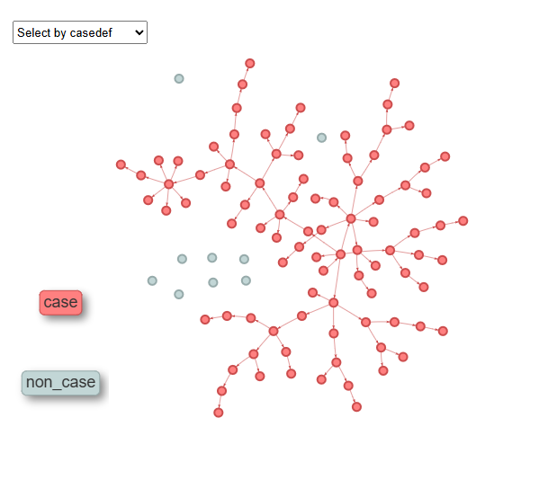

```{r, include = FALSE}
knitr::opts_chunk$set(
  collapse = TRUE,
  comment = "#>",
  fig.path = "man/figures/README-",
  out.width = "100%",
  dpi = 300
)
```


[](https://github.com/thibautjombart/simulacr/actions/workflows/R-CMD-check.yaml)

[](https://app.codecov.io/gh/thibautjombart/simulacr)


# Welcome to the *simulacr* package!

This package is under development. Do not use it without contacting the authors first.

## Installing the package

To install the development version of the package, type:

```{r install, eval = FALSE}
pak::pkg_install("thibautjombart/simulacr")
```

Note that this requires the package *pak* to be installed.


# What does it do?

*simulacr* implements outbreak simulation using contact-driven branching processes. 
The main features of the package include:

- `simulate_outbreak()`: the main function, simulating epidemic spread using inputs
on the generation time distribution, individual transmission rates, and contact
matrices; it outputs a `simulacr` object, which is a list containing a linelist and a transmission tree, which can be converted to `epicontacts` objects for visualisation, and plotted using `plot(...)`

- `simulate_outbreak_step()`: the step-wise version of the simulator, designed for
calling from other packages

- `make_pmf_delay()`: to generate probability mass functions of delays distributions

- `make_disc_gamma()`: to build discretised Gamma distributions for delay distributions

- `make_panmictic_contacts()`: to generate a contact matrix assuming random mixing
  
- `draw_labels()`: wrapper function to generate random alphanumeric labels

<br>


# Worked example

This brief example illustrates how we can simulate an outbreak.

```{r }
library(simulacr)

## make a generation time distribution
gen_time <- make_pmf_delay(make_disc_gamma(10, 7))
plot(
  gen_time(0:30), type = "h", lend = 2, lwd = 10, 
  main = "Generation time distribution", 
  xlab = "Delay from primary to secondary infection (days)", 
  ylab = "p(delay)"
)

## simulate an outbreak using random mixing 
## (no contacts matrix provided -> all individuals are in contact by default)
set.seed(1)
res <- simulate_outbreak(
  n = 100, # 100 individuals in the population
  duration = 365, # simulate for a year
  w = gen_time, # generation time distribution
  tau = runif(100, 0.01, 0.05) # individual transmission rates, from 0.01 to 0.05
)

names(res)
res

```

```{r eval = FALSE}
plot(res)
```


Note: for the interactive version of this plot, check the simulacr [website](https://thibautjombart.github.io/simulacr/).


# Resources

## Vignettes

No vignette currently available.


## Getting help online

Bug reports and feature requests should be posted on *github* using the [*issue*](http://github.com/thibautjombart/simulacr/issues) system. 


Contributions are welcome via **pull requests**.

Please note that this project is released with a [Contributor Code of Conduct](CONDUCT.md). By participating in this project you agree to abide by its terms.

